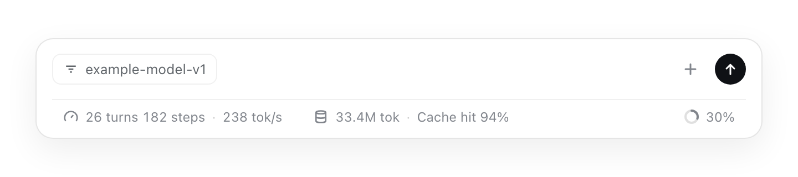

# dsh-context-usage-guard

Keeps the DeepSeek Harness composer's context-usage ring honest: an empty usage
sample during a retry no longer collapses it to `0%`, and its percentage is
typeset at the size of the figures beside it.
**English** | [简体中文](README.zh-CN.md)

[](LICENSE)
[](https://github.com/icrefin/dsh-context-usage-guard/releases/tag/v0.2.2)
[](https://github.com/icrefin/dsh-context-usage-guard/actions/workflows/ci.yml)
[](https://github.com/icrefin/dsh-context-usage-guard/commits/main)
[](https://github.com/icrefin/dsh-context-usage-guard/stargazers)
[](https://github.com/icrefin/dsh-context-usage-guard/pulls)
[](https://nodejs.org)
[](https://github.com/deepseek-ai/deepseek-harness)

A [DeepSeek Harness](https://github.com/deepseek-ai/deepseek-harness) (dsh)
plugin that repairs two defects in the composer's **context-usage ring** — one in
the value it shows, one in how large that value is drawn:

1. the ring stops dropping to `0%` while a model request is being retried — the
   host half; and
2. the ring's percentage renders at the size of every other figure on its own
   line — the browser half, one stylesheet rule.

## The two bugs it repairs

```
One line, in the composer footer:

  182 steps · 238 tok/s      33.4M tok · Cache hit 94%      ◯ 30%
                                                             ↑
              the ring's 30% was one pixel larger than every other figure

Mid-retry, the same ring read 0% instead of holding the last real reading:

  ◯ 0%   →   ◯ 6%
```

### The ring collapses to `0%` while a request is being retried

The ring renders the session projection `contextPressure`. That projection takes
the **newest usage sample** as the current prompt size and publishes:

```text
pressureTokens  = usage.inputTokens + cacheReadTokens + cacheWriteTokens
projectedTokens = max(0, pressureTokens + surfaceTokens - sampledSurfaceTokens)
```

A model call that fails before the provider reports anything — a `429`, a rate
limit, a timeout, a transport error, or a user cancellation — still ends its
stream with a `usage` chunk:

```jsonc
[ { "type": "chunk", "chunk": { "type": "usage",  "usage": { "inputTokens": 0, "outputTokens": 0, "totalTokens": 0 } } },
  { "type": "chunk", "chunk": { "type": "finish", "reason": { "kind": "error",
      "failure": { "code": "RATE_LIMIT", "message": "429: token_capacity_exceeded" } } } } ]
```

The adapter's accumulator starts at zero and nothing ever overwrote it, so this
sample is *empty*, not a measurement. But it is the newest sample, so
`pressureTokens` becomes `0`, and because the sample is stamped at the current
surface total the projection publishes `projectedTokens: 0`. `@deepseek-ai/dsh-llm-retry`
then retries the same step — six times in the session this plugin was written
from — and the ring reads `0%` for the whole storm, misreporting a context that
never changed.

Measured against the shipped `contextPressure` fold, replaying that session's
real events (`test/fold.spec.ts`):

| Replay | `pressureTokens` | `projectedTokens` | Ring |
|---|---|---|---|
| after the last successful call, before the retry | 64 389 | 64 389 | `6%` |
| the failed attempt, **unguarded** | 0 | 0 | `0%` ← the symptom |
| the failed attempt, **guarded** | 64 389 | 64 389 | `6%` |
| the retried step finally succeeds | 64 575 | 64 575 | `6%` |

### The percentage is one pixel larger than the figures beside it

The same footer band holds the session statistics and the ring, and the two
shipped stylesheets disagree by one pixel about how big a figure is:

```css
/* @deepseek-ai/dsh-client-ui-chat — StatsPills.module.css, the pills */
.Q51KRG_trigger { font-size: calc(var(--dsh-content-font-size-secondary,13px) - 1px) }

/* @deepseek-ai/dsh-client-ui-conversation — ContextMeter.module.css, the ring */
.JObwrW_trigger { font-size: var(--dsh-content-font-size-secondary,13px) }
```

Both prefixes are content-hashed per build — the pair above is what the
`0.2.1-rc.5` packages installed here carry; the *declarations* are what matters,
and `test/meter-typography.spec.ts` re-reads them from the installed packages
rather than trusting this block.

So `30%` renders about 8% larger than the `182 steps`, `238 tok/s`, `33.4M tok`
and `Cache hit 94%` beside it, which reads as a different typeface. Measured on a
screenshot of that line: every other figure has a 12 px cap height, the ring's
has 13–14 px — a ratio of 1.08, exactly `13 ÷ 12`. The meter's own breakdown
panel is already `12px`, so the trigger is the outlier.

## What the plugin does

| Half | Surface | What it does |
|---|---|---|
| Host | `llm/stream` waterfall | one listener that withholds an empty usage sample belonging to a failed attempt, so the projection keeps its last real reading |
| Browser | the document `head` | one self-tagged stylesheet rule that puts the meter's percentage at the statistics pills' figure size |

Neither half adds a page, a route, a settings section or a stored file. The host
half declares `inject: ['llm']`, so the LLM service must exist first, and it
registers inside `ctx.effect`: cordis runs the disposer on unload, when the
profile patch disables the row, or at shutdown — a bare `ctx.on` would leak the
listener past unload.

One rule, applied to the chunk stream of every model call:

> A usage sample whose **every reported count is zero** measures nothing. When it
> belongs to an attempt that ended in `error` or `aborted`, it is dropped, so the
> previous real reading stands.

Everything else passes through untouched:

- **a successful completion**, whatever it reports — `stop`, `tool-calls` and
  `max-tokens` are authoritative provider answers, so a zero there is left for
  the consumer to judge;
- **a failed attempt that did report something** — a partial call can carry real
  input counts, so no billed counter is ever discarded;
- **stream shape, order and timing** — the withheld sample is the only chunk that
  moves; visible deltas keep their order and the terminal `finish` the retry
  executor reads is preserved.

## How the fix works

### Host half: the sample that decides the reading never lands

The wrapper holds **at most one** `usage` chunk and releases it immediately
before the next chunk, so the only chunk whose position can change is the sample
that decides the outcome. A stream that ends without its terminal `finish` still
releases a held sample — the guard never swallows information it did not
positively decide to drop. Withholding the chunk is legal in the stream protocol:
`usage` may appear at most once and is never required, `BlockAssembler.usage`
stays `undefined` without it, and the agent loop already omits the durable
event's `usage` field rather than failing. Token accounting is unaffected — the
projection's usage fold adds an empty sample's buckets as zero anyway, which
`test/fold.spec.ts` pins directly.

### Browser half: one stylesheet rule

The browser half adds one stylesheet rule that repeats the statistics
declaration verbatim:

```css
button[aria-haspopup="dialog"]:has(> svg > circle) {
  font-size: calc(var(--dsh-content-font-size-secondary,13px) - 1px);
}
```

- **Structural selector, not a class name.** The meter's button is the only
  dialog-opening control whose icon *is* the ring — an inline `<svg>` with
  `<circle>` children — while the statistics pills draw `<path>` icons. A build
  that re-hashes every class name cannot break the rule, and the pills can never
  match it. Specificity `(0,1,3)` beats the shipped `(0,1,0)`, so there is no
  `!important`.
- **One declaration.** Nothing is hidden, moved, recolored or replaced; the line
  box is unchanged, because both shipped rules already share `line-height`.
- **Self-limiting.** `test/meter-typography.spec.ts` reads both declarations out
  of the installed packages and fails when they converge, so a release that fixes
  the trigger upstream says so instead of leaving a silent workaround behind.

## Screenshot



The footer band as `tools/preview.mjs` renders it outside the GUI: the pills'
`26 turns 182 steps · 238 tok/s` and `33.4M tok · Cache hit 94%`, and the ring's
`30%`, now share one figure size — all of it drawn from the installed
`dsh-client-ui-chat` and `dsh-client-ui-conversation` stylesheets. The figures
are a replay of plausible session projections, not a capture: the harness never
reads a session log, a profile or the network.

## Requirements

| Requirement | Version | Notes |
|---|---|---|
| DeepSeek Harness | `>=0.2.1-rc.5 <0.2.2-0` | the `dsh` range this build is pinned to (verified on 0.2.1-rc.5); peers are `@deepseek-ai/cordis` ^4.0.5, `@deepseek-ai/dsh-llm` 0.2.1-rc.5 and `@deepseek-ai/schemastery` ^3.18.5 |
| Node.js | `>=22.17.0` | `engines.node` in `package.json` |
| pnpm | `11.20.0` | only for developing this repository: `pnpm check` and `pnpm build` |
| Google Chrome, Chromium or Edge | any recent | only for `tools/preview.mjs`, the screenshot harness |

The built halves are committed in `lib/`, so installing the plugin needs no build
step and no toolchain beyond the harness you install it into.

## Install

```sh
git clone https://github.com/icrefin/dsh-context-usage-guard.git
cd dsh-context-usage-guard
sh scripts/install.sh
```

`scripts/install.sh` packs `dist/dsh-context-usage-guard-0.2.1.tgz` and prints the
path to give the app. The desktop profile is owned by the Electron application,
so `dsh plugin add` refuses it: install the tarball from **Settings → Plugins**
(or with the plugin-manager tool), then **restart**. A bundle added to a running
profile cannot be imported by that process — its module path is not in the
resolution the harness computed at boot — and the browser half additionally needs
the page reloaded.

To run the suite before or after installing:

```sh
pnpm install
pnpm check     # tsc over both halves, then 40 tests in five suites
```

Two operational notes:

- **Reinstalling the same version is a no-op.** pnpm sees an unchanged spec and
  leaves the extracted copy in `node_modules` alone, so a rebuilt tarball at the
  same version does not reach the profile. Remove the bundle first, then install
  it again — or bump the version.
- **A host-side change reaches the running app only on the next start.** On the
  first install the host listener activates and the browser half registers as
  soon as the install finishes. After that the two halves diverge: the browser
  bundle is re-imported when its revision changes, but the host half is a
  boot-time ESM import and keeps serving the code the process started with.
  This is upstream behaviour; client-side changes never need a restart.

### Uninstall

Remove the bundle from **Settings → Plugins** (or with the plugin-manager tool)
and restart. Nothing else is written: no route, no file, no stored state. The
stylesheet goes with the bundle — the client module system evicts any `<style>`
tagged for this package, and the plugin's own effect removes it even earlier.

## Configuration

The row's `Config` is the settings namespace, so the values live in the row's
`config` in `<profile>/cordis.patch.yml`:

```yaml
- id: dsh-context-usage-guard
  config:
    enabled: true
    logHeldSamples: false
```

| Field | Type | Default | Meaning |
|---|---|---|---|
| `enabled` | boolean | `true` | While off, every stream is passed through untouched. |
| `logHeldSamples` | boolean | `false` | Log one host line per withheld sample: route and failure code. |

Both fields are volatile, so a change applies to the next request with no reload.
The defaults change nothing except the repair itself: a fresh install behaves
like a stock one that keeps its context reading honest.

```text
[dsh-context-usage-guard] held an empty usage sample from a failed request
  (example-provider/example-model-v1, RATE_LIMIT); the context reading stays at its last value
```

## What this plugin deliberately does not do

- **It does not touch the projection registry.** `dsh-token-meter` registers
  `contextPressure` internally and the registry *shares* a key rather than
  replacing it, so a second registration cannot override the fold, and
  re-registering the same key first would hijack a package this plugin does not
  own. Repairing the fold's input is the narrow fix; the fold itself is left to
  its owners.
- **It does not replace or restyle the ring's component.** The meter is rendered
  inside `dsh-client-ui-conversation`'s input bar with no extension seat. The one
  thing the browser half does is add a `font-size` declaration to the trigger the
  statistics already prove is wrong; the ring, its icon, its colors, its hover
  state and its dialog are the shipped ones.
- **It does not invent a number.** When nothing measurable has ever been
  reported, the projection stays absent and the ring stays hidden — the shipped
  behavior — rather than showing a value nobody measured.
- **It does not freeze the reading.** The next successful attempt reports real
  usage and the ring advances, which the suite asserts.

## Limits

- **The repair is about *failed* attempts.** A successful completion reports what
  the provider sent, zeros included, because a `stop`/`tool-calls`/`max-tokens`
  answer with zero counts is still an answer. The plugin never overrides a
  provider's own numbers.
- **The browser half is a workaround with a built-in expiry.** It exists because
  the two shipped declarations differ; the moment they converge the suite fails
  and the rule should be deleted rather than kept.
- **Its pixels are checked outside the GUI, not inside a live session.**
  `tools/preview.mjs` renders the real bundle and the real stylesheets in headless
  Chrome and fails unless the meter matches the pills; what the running app paints
  with a user's own theme and font settings is not asserted automatically.
- **The host half only sees calls that use the LLM service.** It sits on the
  `llm/stream` waterfall, which is where the harness routes model calls; a
  provider reached around that service is neither guarded nor broken by this
  plugin.

## Troubleshooting

**The ring still reads `0%`.** Check that `enabled` is `true`. If it is, the
reading came from a call that completed successfully: the guard withholds empty
samples only from attempts that ended in `error` or `aborted`, and a successful
answer reporting zero is left for the consumer to judge. Once a retried step
succeeds, the next real usage sample takes the reading over again.

**The percentage still looks larger than the figures beside it.** The rule is
installed when the browser half registers, so a plugin installed into a running
app needs the restart described in [Install](#install) and then a page reload.
After that, `test/meter-typography.spec.ts` is the authority: it fails when the
shipped declarations converge, which is the signal to delete the rule.

**No `held an empty usage sample` line appears in the log.** That line is behind
`logHeldSamples`, which defaults to `false`; the repair itself does not depend on
it. Turn it on and the next withheld sample prints the route and the failure code.

## License

MIT — see [LICENSE](LICENSE).

> If this plugin keeps your context reading honest, a ⭐ star helps other DSH
> users find it.

---

Built for DeepSeek Harness `0.2.1-rc.5` · MIT · [issues and pull requests](https://github.com/icrefin/dsh-context-usage-guard/issues) are welcome.
